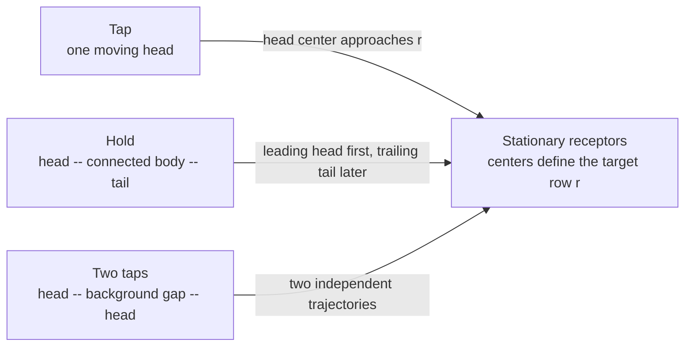

# Reading gameplay from video

This document defines the visual evidence and the conclusions it can support, independently of the analyzer's implementation. It describes the usual Phoenix note skin seen in the recordings reviewed here. Other skins, perspectives and game versions require their own observations. A threshold passing in code is not proof that a visual interpretation is correct.

## Coordinates and the target row

Use the cropped game image, with the origin at its top-left corner, x increasing rightwards and y increasing downwards. Moving notes approach the stationary receptors from below: ordinary forward scrolling decreases y. Five receptor columns form a single panel; double charts use ten ordered columns. Player ownership must come from the observed layout, not from the number of moving notes in a frame.

The receptors are the stationary gray arrow/center outlines near the top of gameplay. The useful registration row passes through their centers. It is not the top or bottom of their outline, the life bar, the bottom of a flash, or a line inferred from where a played note disappears. A bright receptor may have an enlarged or asymmetric bounding box.

For a standard full, unmirrored game image, receptor positions may instead come from a declared
fixed game-layout profile. This is the default policy: Single-left, Single-right and Double have
separate profiles. The chart mode and Single player side must be known; an explicit layout overrides
the profile. Record this as a geometric prior, not as directly detected receptor evidence. Existing
observations retain their original reviewed geometry. For image-derived fallback geometry, prefer
unlit outlines corroborated at different source times; missing receptors cannot be supplied solely
by extrapolating a convenient equally spaced grid.

Call the receptor registration height **r**, the horizontal lane centers **x_i**, and the median distance between neighboring lane centers **s**. For a moving head, call its registration height **y_i(t)**. The visual target time solves:

```text
y_i(T) = r
```

This is a visual alignment estimate. The exact game-engine anchor, its judgment windows and the physical switch timestamp are not established by a screenshot. Bounding-box centers of different nested outlines may differ by pixels. An absolute timing claim needs a verified registration convention and independent latency calibration.



## Size, position and visibility

**Lane spacing is not note size.** Measure horizontal spacing from receptor centers, and head width/height from complete moving outlines. Both change under image resizing, but their ratio need not be exactly one. Arrow direction, nested borders and skin design affect the bounds. Use a consistent outline or template registration point for each shape; do not mix the center of an inner ring with that of an outer silhouette without accounting for the offset.

At the inspected 1300 x 730 game crop, neighboring receptors are about 77 pixels apart and their
center row is about y = 104. Complete moving-head contours include roughly 71 x 71-pixel inner
outlines and approximately 75-80-pixel outer bounds. These are observations of this crop, not
constants for another video. At 650-pixel analysis width, the same geometry is approximately half as
large. A one-pixel position error contributes roughly `1 / scroll_speed_pixels_per_second` seconds
to a crossing estimate.

Convert coordinates using each image's actual dimensions. Rounding the resized height can make the vertical scale differ from the horizontal scale: a 650 x 365 analysis image becomes 325 x 182, so vertical coordinates scale by 182/365, not 325/650. Positions and velocities on the same axis must use the same transform.

A head is fully visible only when its relevant outline is inside the visible field and not clipped by the receptor mask, screen edge or overlay. A partial contour's bounding-box center can move even when the original head does not. Such centers must not be treated as equivalent to intact-head observations. The lower boundary must be checked as well as the receptor boundary.

White outlines, lane color, shape, size and trajectory jointly support a head. Color alone also occurs in backgrounds and effects. Multiple nested outlines in one head are not multiple notes. A detector should preserve its observed bounds and registration convention when it acquires them, so later stages can examine this distinction without decoding the video again. Saved traces with centers but no head bounds cannot support bounds-based checks; absent bounds must not be invented.

## Motion and time

Every observation retains its original source PTS and recording playback time. Duplicated rendered images in distinct captured frames are still distinct observations of the recording. They do not imply that a note stopped in the game, and they do not provide independent measurements of a new position.

Within a supported constant-speed interval:

```text
y(t) = a - v*t,  v > 0
T = (a - r) / v
```

With a shared forward displacement **d(t)**, notes moving together instead satisfy `y_i(t) + d(t) = c_i`. Their relative vertical spacing is preserved. This permits a hidden head to be located using independently visible peers, as long as the correspondence is unique and support continues across the relevant interval. Repeated evenly spaced patterns can produce more than one plausible displacement; that ambiguity must break support.

Equal pixel gaps imply equal time gaps only where the displacement-to-time mapping is linear. Under speed changes, equal pixel gaps need not mean equal musical or recording-time gaps. Do not snap targets to integer frames or assume a song-wide scroll speed. Continuous interpolation can improve relative timing while capture cadence, fit residual, position error and unknown capture phase still limit absolute accuracy.

A disappearance is an observation gap, not proof of a note ending, a successful press, a MISS or a gimmick. Seek in both directions. A matching trajectory before and after an overlay can establish one note. Reconnection requires lane, position, motion and unique identity; proximity in time alone is insufficient. Visible detections that cannot be retained or accounted for must remain reviewable, with a warning unless a human-authored chart-region exception covers them.

## Taps, holds and two adjacent heads

A tap has one approaching head. A normal hold has a leading head, a colored connection extending below it, and a trailing tail. Both caps can look like ordinary arrows. The tail reaching the receptor ends the chart's hold duration; it is not an additional tap. The panel may already be held before the head and may remain held after the tail.

To distinguish a hold from two taps, inspect several nearby frames:

| Visible evidence | Supported interpretation | Insufficient evidence |
| --- | --- | --- |
| Upper and lower caps with a persistent colored connection translating together | One hold with head and tail | Similar color and close target times alone |
| Background separates two independent complete heads through their approach | Two taps | One frame where an overlay hides the gap |
| A narrow connected component follows a hold edge across frames | A possible body/cap fragment of that hold | A component anywhere inside its time envelope |
| Body reaches the receptor and remains while its lower edge approaches | Ongoing chart hold | Receptor light alone |
| Body or cap disappears under a flash, then reappears consistently | Temporarily obscured hold | Treating disappearance as an exact end |

The head's center lies inside the body's upper outer bound, and the tail's center lies inside its lower outer bound. For an approximately square cap of height **h**, an initial geometric approximation is:

```text
head_center ~= body_top + h/2
tail_center ~= body_bottom - h/2
```

The exact offsets depend on which colored component or outline defines the body bounds. They require
measured cap geometry or an explicit approximation with uncertainty. These are position
relationships, not a minimum hold duration. A short hold can have closely spaced caps; a
minimum-duration cutoff cannot replace evidence of a connected body. Once a cap trajectory
identifies the endpoint directly, use that trajectory's crossing uncertainty. The positional
tolerance used to decide which cap belongs to the body is not an additional error on an already
measured crossing.

A brief visible body can still be identified when both independent cap
trajectories are already fitted. Four source observations with strong original
stripe support, the same two cap identities, four distinct cap positions,
no capture gaps above 50 ms and
at least half a lane spacing of observed travel provide a bounded alternative
to the usual five-frame/80 ms persistence check. Both edge alignments remain
mandatory. This is not a shorter minimum chart duration, and weak stripes,
stationary corners or missing endpoints remain unresolved.

A connected interior stripe can begin below the head center and end above the
tail center. Its bounds use a different registration convention from the outer
cap silhouette. Corroborate stripe boundaries with independently tracked cap
centers at the same source timestamps. A cut at a judgment word or counter is an
occlusion boundary, not a cap. Do not close ordinary gaps between adjacent tap
heads merely to obtain a continuous colored component.

A thin white cap border can separate a short hold's colored cap from its
colored stem. A second pixel channel may include actual white pixels within
approximately 0.08 lane spacings of the original color, without filling any
background pixels. This channel is limited to short components (1.6-3.5 lane
spacings high) with an observed colored connector across their middle. White
borders touching without a colored connector do not establish a hold. Endpoint
identity still requires the independent native cap trajectories.

Inspect a suspected short connection throughout both caps' approach, including
frames that did not produce a body candidate. Selecting only the frames where
two animated cap corners touch biases the evidence toward a hold. The saved
color trace distinguishes a strong vertical column, a weak or dim possible
column, and absence of even a relaxed color column across three rows. Weak
support is unknown, not an observed gap. HUD cuts and unstable cap separation
cannot establish a gap. Repeated clear separation can refute a short hold while
preserving both independently tracked taps and their timing warnings.

Only compare an extended body's edges while they are visible. A screen-clipped lower edge is not a tail. A top clamped at the receptor is not an approaching head. As the body shrinks, both caps can enter the same tolerance; these samples cannot independently distinguish the endpoints.

Closing small holes in a color mask can repair compression or HUD damage, but can also join two
taps. A repaired bounding box is therefore a candidate, not independent proof of a continuous hold.
Preserve support from the original pixels. Weaker continuity requires additional endpoint
corroboration; neither relaxing a color threshold nor fitting two arrows to the repaired box proves
the intervening pixels are a body. Cases where the gap and body remain indistinguishable need
review, not forced classification.

For each retained hold, record its observed body interval, linked head/tail identities, supported endpoint ranges and unresolved clipping. Do not suppress a separate tap merely because it falls within an uncertain endpoint range. A cap directly linked to the connected edge is stronger evidence than membership in an expanded time envelope.

## What indicates input or a judgment

A hold is one continuous held-state requirement. Its leading cap (often drawn like a note head) is a skin-dependent visual boundary, not an additional tap. A panel already held before that boundary can satisfy the hold; no new press onset at the cap is required. A separate tap at the boundary requires independent visible chart evidence and must not be inferred from the cap artwork. Ordinary UCS uses one `M`/`H`/`W` interval, without an extra `X` for its cap.

The game accepts an ongoing hold state while the panel remains held. Hold ticks and repeated combo/judgment updates are not repeated presses. A lit receptor during a body can support ongoing recognition. Its disappearance does not identify the physical release time.

A tap's evidence may include a lane-local receptor transition and a corresponding combo or judgment refresh. A persistent lit receptor cannot independently support several repeated taps. A whole-screen flash is not ten simultaneous inputs. Unknown or obscured samples must remain unknown. The relevant transition may occur in a neighboring frame; all evidence need not coexist in one image.

A weak hold response can be corroborated by a lane-local brightness pulse and a positive HUD refresh while independent neighboring frames establish that hold. Requiring the body to be detected again in the pulse frame would discard valid occlusion evidence. Use the certain interior of the established hold for this additional support; a pulse, HUD refresh or guessed body alone cannot create a hold.

Keep a response-association search window separate from chart endpoint uncertainty. A rendered
response can still be visible near the trailing cap as it overlaps the receptor. A bounded cap-sized
positional neighborhood can be converted to a time search using the observed scroll velocity, with
the assumption made explicit. This does not move the measured target, assert a physical release, or
justify absorbing a separately observed next tap. Only actual receptor observations inside that
search become recognition evidence; the window itself is not an input range.

The interval from the last old display to the first new display brackets a visible refresh, not a physical switch closure. Confirming the new display in later frames must not move the bracket to the later confirmation. PERFECT/GREAT/GOOD/BAD can provide refresh evidence where combo digits are absent. MISS is failure evidence and must not receive a fabricated press time. A persistent word is not a fresh judgment for every nearby note.

Display updates can aggregate simultaneous notes, hold ticks or multiple judgments between captured frames. The analyzer's row-grouping model is an association assumption, not a verified universal rule for every game mode. Preserve aggregate brackets and competing interpretations instead of inventing per-note timestamps. Validate update-count semantics separately from head detection.

Separate these quantities in reports:

| Quantity | Meaning |
| --- | --- |
| Chart target range | Uncertainty about when a registered head/cap aligns with the receptor row |
| Observed refresh range | Original source-frame bracket for a visible game-display change |
| Estimated input range | Refresh bracket after an explicitly selected display-delay correction |
| Hold recognition span | Interval with observed sustained acceptance support; not measured press/release |
| Candidate range | An admissible unresolved association, with its assumptions and alternatives |

The chart target range is not a PERFECT/GREAT judgment window. A result-panel grade cannot calibrate the receptor row or shrink a target range unless an independently validated model relates them. Stage totals are consistency checks: compare compatible judgment units, account for hold ticks and aggregations, and preserve conflicts. Never fill missing links to satisfy a result quota.

## Review procedure

1. Verify the game crop, stationary receptor centers, lane ownership and scale against several source times. Include quiet outlines and flashes.
2. Inspect a complete head away from the boundaries. Identify the outer bounds and the registration point. Record its size separately from lane spacing.
3. Follow the same object through nearby source frames. Explain every fragment, clipping event and change in visibility.
4. For an apparent hold, verify the connection and both cap trajectories. For apparent two taps, look for the persistent background gap. Record which evidence could distinguish them and which is missing.
5. Estimate target ranges from supported motion; then examine receptor and HUD refreshes independently. Do not adjust geometry to obtain a convenient match.
6. Check other lanes, real nearby taps, short holds, clipped tails, HUD occlusions and speed changes as negative/control cases. A fix should explain why the control cases remain different.
7. Compare coverage and result counts in compatible units. Review new suppressions as well as recovered notes. Preserve original observations and report unresolved evidence.


## Relationship to implementation

[Play analysis](play-analysis.md) describes commands, current thresholds, artifacts and
compatibility rules. The model above is the review criterion for those choices. Current limitations
include using lane spacing as an approximate cap scale, saved observations without head bounds, and
body endpoints extrapolated from small color masks. Those approximations must be named and carry
uncertainty; they are not facts about the game. Improvements should replace them with measured
evidence where available, while retaining a traceable fallback for older observations.

A chart can stack scoring rows so that a single visible processing moment
advances the counter by a configured amount, such as ten. The counter change
alone cannot distinguish this from dropped intermediate reads or rapid normal
rows. Verify the source sequence and scope the exact increment in chart
metadata. This changes counting semantics, not the measured refresh bracket;
independent lane evidence and unique visible-row ownership are still required.

The [gameplay screen map](gameplay-screen-map.md) lists fixed geometry, named
foreground occluders and the strict per-frame visibility/motion warning policy.

## Shared timing and beat reconstruction

Final registered trajectories can corroborate displacement without guessing
which equally spaced outline in a repeated pattern corresponds to the next
frame. Shared steps require two independently positioned track identities;
near-coincident fragments of one same-lane cap cannot supply that support.
Each accepted head uses the same measured displacement scale. A genuinely
isolated head can use its explicitly identified bounded native-track fit;
that method cannot silently replace failed shared support among visible peers.

A linear shared clock must explain displacement within capture/position noise.
Its target must lie inside the native crossing bracket expanded only by the
measured capture cadence and positional error. A long-window average outside
that envelope is rejected. After rejecting a whole-block clock, also test the
native observations within 500 ms of the measured crossing. This local clock
must meet the same sample-count, duration, residual, velocity-consistency and
crossing-envelope gates. Retain a rejected block clock alongside a successful
local fit; never substitute an unverified interpolation. Motion discontinuity
warnings remain independent of clock selection. Repeated native co-observations also constrain
relative note spacing in pixels. Incompatible shared clocks or predicted gaps
beyond measured spatial scatter produce reconstruction failure, regardless of
successful combo or grade association. Failed trajectories retain their source
points and rejected estimate for review and do not enter normal associations.

When official UCS timing and a verified recording-to-song translation are
available, compare bounded four-beat groups against natural `Split` candidates
1, 2, 3, 4, 6, 8, 12, 16, 24, 32, 48, 64, 96 and 192. Use the smallest split
that explains the group, preserving distinct rows. Multiple admissible rows
are a failure, not permission to choose a convenient nearest cell. Unsupported
positions, uncertain phase, timing outside official sections and conflicts
with observed spatial spacing remain explicit failures. One common song-phase correction must satisfy every accepted group within
the independently measured audio-alignment uncertainty. The phase search has
a resolution of at most 1 ms, retained explicitly in its uncertainty range;
native source timestamps are unchanged. Conflicting group
phases fail; each note cannot choose its own phase. Accepted beat times
retain the original video estimate/range and alignment uncertainty. Input
associations are recomputed before word grading after chart targets change.
Missing UCS identity or verified alignment is explicitly unverified with a
warning; the video timing is not labeled as a verified beat reconstruction.

`timing-reconstruction.json` and `beat-timing.json` retain these states. Reports
show failures and individual warnings. General timing exclusions do not hide
the separate `timing_reconstruction` check. A concrete reviewed exception can
scope a special chart behavior without erasing native observations.

A shared displacement coordinate system needs independent visible heads to
establish it. Once established, a previously corroborated trajectory can carry
that coordinate system through a brief loss of its peers while its own actual
position is still measured in every intervening native frame. The implementation
bounds this continuation to 250 ms after the last independent corroboration.
It records `registered_identity_continuation`, retains original source PTS and
increases positional uncertainty. A blank observation, capture gap, different
unanchored identity or expired bound breaks the coordinate system. This does not
establish shared motion from a lone head or extrapolate through missing pixels.

### Measured relative scroll speed

For a bounded abrupt speed change, independent peer displacement can establish
stable velocities on both sides and a continuous intersection between them.
Record the measured after/before ratio with uncertainty, native boundary frames
and the official BPM context separately. A screen ratio does not identify the
player's absolute speed setting or prove that BPM alone caused the change.
Concrete metadata may authorize a piecewise displacement clock only where a
head's own pixels agree with that model. Sparse support, ramps, reverse motion,
multiple nearby changes and inconsistent positions remain explicit review cases.
See [the measurement workflow](development.md#measuring-scroll-speed-changes).

When simultaneous heads enter the receptor exclusion area together, independent
peer detections may end shortly before receptor alignment. A stable shared clock
can bound that final approach without claiming the head was observed at the
receptor: extrapolation is limited to 1.1 lane spacings and 250 ms, carries
positional/speed uncertainty and names its last supported frame. The original
recording must continue across the predicted target without a native-frame gap.
A new corroborated motion block before the predicted target, unstable clock, censored recording or longer
unobserved approach prevents this inference. This is chart-target evidence,
not physical input or an observed disappearance.

A tracker can briefly alternate two identities for the same physical head.
Their time spans may overlap even though they never appear in the same native
frame. Such fragments may be joined only with one corroborated registered-motion
chunk, short overlap (at most 100 ms), a consistent pixel offset, sufficient
observations on both identities, and a unique partner. Co-observed heads,
competing partners, different paths and unsupported motion stay separate.
Joining sorts and retains every original point and source-fragment identity;
it does not synthesize a detection in a missing frame. Final shared timing and
visibility checks still apply to the joined trajectory.

A successful target estimate does not make a trajectory complete. Its uniquely
corroborated later reappearance can still be joined without discarding native
points. Conversely, two targets within a few captured frames are not proof of
a duplicate: collapsing head components requires matching same-lane positions
in at least four shared native frames. Distinct co-observed heads stay distinct
even when their target times are close.

### Joint registration of shared displacement

Summing frame-to-frame median displacements can accumulate bias from pixel
quantization and changing peers. Instead, identified heads jointly constrain
`y_i(t) + d(t) = c_i`: each head has one offset within a connected observed
motion block, and each native frame has its own displacement. Robust least
squares estimates those coordinates without a BPM, presumed note grid, FPS
conversion or constant-velocity assumption. Stops and changes of speed remain
in the measured frame coordinates.

The original signed peer-step measurement and accumulated pairwise phase are
retained alongside the refined phase. The solver changes derived coordinates only.
Source detections and PTS remain
immutable. It retains per-block fit residuals, head offsets and native support;
points outside the existing position-fit gate produce
`shared_motion_observation_conflict` warnings even when a robust target can be
estimated. Disconnected identities, nonconvergence and motion contradicting the
forward model fail explicitly and cannot supply a shared clock or speed proposal.
Small forward adjustments are bounded by the positional noise floor and recorded.
Known capture gaps still separate motion blocks. Shared targets use the jointly
estimated offset, rather than independently rescaling each head's trajectory.

An inner white contour may be narrower than the colored cap rim. A stem can
connect along that outer rim, outside a crop derived from the inner contour.
Tap separation must inspect the owned lane through the full cap, rather than
cutting away the side connection and fabricating background margins. A visible
short connector that does not yet prove a hold remains unknown; it is not a tap.

Observed cap ownership is independent of accepted chart time. A sufficiently
observed forward-moving native cap can identify a body edge even when its beat
or shared target failed. Keep that observed owner separate from an endpoint with
an accepted timestamp. A closer untimed or uncertain candidate blocks a farther
timed tap from taking the edge. Stationary or short unaccepted candidates remain
unresolved; a chart-time failure is never repaired merely by assigning a cap.
Body continuity can use observed caps without timestamps. A projected hold head
retains its native owner's reconstruction failure instead of creating a clean
synthetic head that bypasses it. Type evidence may use the independently observed
head and tail identities while timing remains unresolved.

A final fragment with fewer than four supported observations cannot erase an earlier
shared approach solely because peers left the detector field. The earlier clock
may supply a target only under the existing 250 ms / 1.1-lane extrapolation limits,
with intact source frames and no subsequent independent motion before the target.
Every later native position must agree with that clock within its retained timing
uncertainty plus the positional floor. Contradictory positions or a new supported
motion block prevent recovery; all original observations remain available.

A connected colored stripe must also fit the calibrated note width. A same-hue BGA
component touching a cap can contain a remote straight column; connectivity alone
does not make that column a hold stem. A component wider than the maximum complete
cap width (1.25 lane spacings) cannot prove a hold. If its overlap also prevents
clear cap margins, that native frame remains unknown rather than proving a tap.

Spatial checks compare jointly registered head offsets in actual co-observed frames.
Different clock windows can have different fitted velocities after capture jitter
or a real speed transition; multiplying their averaged velocity by the difference
between targets is not a valid screen-distance measurement. A beat adjustment is
converted back into displacement with each head's own supported clock and applied
to its registered offset. Missing common offset support is an explicit
`shared_spacing_model_unavailable` failure. The native pixel tolerance is unchanged.

Two native coordinate blocks can transfer a target without extending an old clock
through new motion. At least two independent head identities must have four
observations over 65 ms on both sides, position errors at most 1.5 pixels, and
coordinate-origin shifts agreeing within one pixel. The gap between blocks is
bounded to 100 ms. Every intervening native frame needs an actual observation of
an anchor; missing source frames, contradictory movement and failed coordinate
blocks prohibit transfer. The destination's observed clock supplies the crossing,
including its measured velocity, rather than assuming the previous speed.
Reports retain both block identities, anchor notes, original PTS and phase offsets.

A repeatedly connected cap pair can establish a tail role before either chart
endpoint is accepted. Preserve that observation when full hold geometry fails:
with eight native connection frames over at least 120 ms, 80% connection support,
unique head/tail ownership, and hold-only type evidence for both caps, the lower
cap is not projected as an independent tap or press. Any clear tap observation, observed inter-cap gap,
competing ownership or insufficient connection proof prevents this inference.
The native targets, raw matches and observations remain unchanged; the presentation
retains the tail endpoint and its provenance in `observed_tail_roles`, excludes
it from independent tap matching/UCS placement, and emits
`observed_hold_tail_pending_geometry`. The unresolved hold geometry warning stays
active; a tail role does not repair a failed chart time or invent a head time.

## Registering nested outlines consistently

The inner white contour and the outer colored silhouette can have different
centers, depending on arrow direction and skin. Neither a beat-grid match nor a
successful input establishes their offset. For a complete isolated cap, measure
the connected outer silhouette around the same white contour in the retained
native neighborhood, including its colored rim. Require visible separation on
both sides and exclude clipped patches and known HUD regions.

An observed identity can supply a constant outline-to-silhouette registration
offset when at least eight qualified source frames span 120 ms. Current policy
requires 95% of offsets within one native analysis pixel of their median and a
median absolute error at most half a pixel. Limit correction magnitude to one
tenth of lane spacing. These are registration gates, not permission to move a
head to a beat or change the one-pixel inter-note spacing check. An unstable
calibration and every measured outlier remain explicit warnings. A calibrated
track contributes at least one pixel of position uncertainty to its crossing.

Keep all original detection coordinates, frame times and PTS. Derived trajectory
coordinates use the measured offset, without dropping or inventing observations.
Visibility gaps and appearance/type joins continue using original detections.
Connected hold caps, obscured outlines and unsupported shapes do not inherit a
calibration just because other notes in that lane have one. The calibration
measures a rendering coordinate convention; it cannot establish note type,
judgment, press or release.

A stored neighborhood's center is an integer pixel row, rounded during cropping.
The original contour center can lie on a half-pixel row. Convert the measured
patch offset back into the original image coordinate system by adding
`round(detected_y) - detected_y`; adding a patch-local offset directly to the
fractional detection introduces an artificial alternating half-pixel error.
Keep this patch-origin correction in the measurement record. It does not move
the original observation, relax a fit gate or change source timestamps.

### Registering a cap attached to a body

A continuous colored body makes a cap's full connected-component bounding box
unsuitable as its registration box. It does not move the glyph's registration
point. A compatible skin can instead supply a local white-outline template from
complete, separated caps in the same lane of the same recording segment.

Templates must be supported by at least two independent observed head identities.
Cluster only equal-size outer boxes whose aligned white-pixel Dice similarity is
at least 0.94; keep the original reference pixels and supporting source PTS. Do
not learn from the connected cap being measured or iterate on inferred templates.
A body outside the cap box may differ; white pixels inside it must still match.
A cap with a genuinely different design or an obscured outline remains unsupported.

Search bounded native translations, require Dice similarity at least 0.90, and
reject a competing registration more than 0.75 pixels away unless its similarity
is at least 0.04 lower. Clip/padding validity and lane-color support still apply.
The measured offsets must pass the same repeated-frame stability gates as direct
silhouette measurements. Failed direct registrations are not replaced with a
more convenient template result. Templates provide coordinates only: matching a
glyph does not classify a tap or hold, establish body ownership or prove input.

A neighboring-head spacing check selects a pair when the heads are adjacent in
height. Its common coordinate proof may use every frame where those same two
identities are observed together inside the selected source-time interval, even
if a third head lies between them in some frames. Height adjacency does not erase
simultaneous coordinate evidence. Retain the minimum four registered observations
spanning 65 ms, the observed gap/scatter and the existing pixel tolerance. Do not
borrow support outside the checked interval or from a block lacking either head.
Sort source times independently of trajectory storage order before defining that
interval; processing a short track first must not change the geometry verdict.

The common song phase must explain native inter-head distances as well as timed
beat rows. Evaluate each bounded audio-phase candidate with the same registered
spacing check used for the final output. Prefer the candidate with the most
jointly consistent observed heads, then supported timing targets and simpler
subdivisions. This uses measured geometry, never grades, input associations or
an authoritative note count. A candidate that fits many time intervals while
moving neighboring notes away from their observed separation is not supported.

Record candidate scores and accepted identities. Equal best candidates with
different row configurations or supported identities remain an explicit phase
failure. The representative phase must reproduce the winning support set; do not
average across incompatible spatial solutions. Retain the existing audio bounds,
phase-search resolution, source timing uncertainty and pixel gates.

### A clipped confirmation after clear disappearance

A fast note can have one fully visible clear-absence frame after its last visible
head, followed by a comparison window slightly outside the image. Cropping the
real intersection can corroborate that first absence when at least 80% of both
the window area and the expected colored foreground remain observable. Never
pad unseen pixels as background or move the expected center to fit the image.
Retain the visible area/foreground fractions and original confirmation PTS.

A partial window supplies confirmation only. It cannot establish the first clear
absence, a last-present sample or a passed-receptor conclusion. At least three
full present observations and one full clear absence are still required. Keep
all existing color-overlap, white-core/bloom, HUD, competing-head, source-cadence
and receptor-position checks. Low coverage, loss of the foreground, black/cut
frames, flashes or truncated recording cannot confirm absence. The reported
transition stays bounded by the last full presence and first full clear absence;
the later partial observation never narrows that range. This is processing
information, not proof of a successful grade or a physical switch press.
A strong partial match that may show the head still present refutes the proposed
disappearance instead of being counted as absence or silently ignored. Keep it
as `partial_head_present`; further absence cannot confirm an earlier transition
across that possible reappearance.
