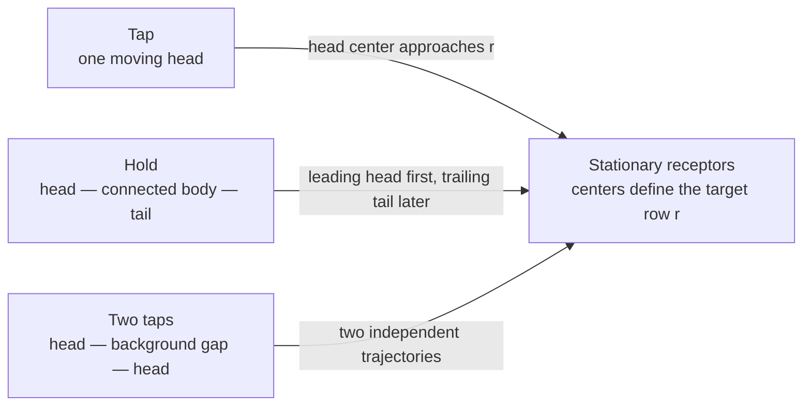

# Reading gameplay from video

This document defines the visual evidence and the conclusions it can support, independently of the analyzer's implementation. It describes the usual Phoenix note skin seen in the recordings reviewed here. Other skins, perspectives and game versions require their own observations. A threshold passing in code is not proof that a visual interpretation is correct.

## Coordinates and the target row

Use the cropped game image, with the origin at its top-left corner, x increasing rightwards and y increasing downwards. Moving notes approach the stationary receptors from below: ordinary forward scrolling decreases y. Five receptor columns form a single panel; double charts use ten ordered columns. Player ownership must come from the observed layout, not from the number of moving notes in a frame.

The receptors are the stationary gray arrow/center outlines near the top of gameplay. The useful registration row passes through their centers. It is not the top or bottom of their outline, the life bar, the bottom of a flash, or a line inferred from where a played note disappears. A bright receptor may have an enlarged or asymmetric bounding box; prefer unlit outlines corroborated at different source times. Missing receptors cannot be supplied solely by extrapolating an equally spaced grid.

Call the receptor registration height **r**, the horizontal lane centers **xᵢ**, and the median distance between neighboring lane centers **s**. For a moving head, call its registration height **yᵢ(t)**. The visual target time solves:

```text
yᵢ(T) = r
```

This is a visual alignment estimate. The exact game-engine anchor, its judgment windows and the physical switch timestamp are not established by a screenshot. Bounding-box centers of different nested outlines may differ by pixels. An absolute timing claim needs a verified registration convention and independent latency calibration.



## Size, position and visibility

**Lane spacing is not note size.** Measure horizontal spacing from receptor centers, and head width/height from complete moving outlines. Both change under image resizing, but their ratio need not be exactly one. Arrow direction, nested borders and skin design affect the bounds. Use a consistent outline or template registration point for each shape; do not mix the center of an inner ring with that of an outer silhouette without accounting for the offset.

At the inspected 1300 × 730 game crop, neighboring receptors are about 77 pixels apart and their center row is about y = 104. Complete moving-head contours include roughly 71 × 71-pixel inner outlines and approximately 75–80-pixel outer bounds. These are observations of this crop, not constants for another video. At 650-pixel analysis width, the same geometry is approximately half as large. A one-pixel position error contributes roughly `1 / scroll_speed_pixels_per_second` seconds to a crossing estimate.

A head is fully visible only when its relevant outline is inside the visible field and not clipped by the receptor mask, screen edge or overlay. A partial contour's bounding-box center can move even when the original head does not. Such centers must not be treated as equivalent to intact-head observations. The lower boundary must be checked as well as the receptor boundary.

White outlines, lane color, shape, size and trajectory jointly support a head. Color alone also occurs in backgrounds and effects. Multiple nested outlines in one head are not multiple notes. A detector should preserve its observed bounds and registration convention when it acquires them, so later stages can examine this distinction without decoding the video again. Legacy traces that save centers alone have less evidence; absent bounds must not be invented.

## Motion and time

Every observation retains its original source PTS and recording playback time. Duplicated rendered images in distinct captured frames are still distinct observations of the recording. They do not imply that a note stopped in the game, and they do not provide independent measurements of a new position.

Within a supported constant-speed interval:

```text
y(t) = a − v·t,  v > 0
T = (a − r) / v
```

With a shared forward displacement **d(t)**, notes moving together instead satisfy `yᵢ(t) + d(t) = cᵢ`. Their relative vertical spacing is preserved. This permits a hidden head to be located using independently visible peers, as long as the correspondence is unique and support continues across the relevant interval. Repeated evenly spaced patterns can produce more than one plausible displacement; that ambiguity must break support.

Equal pixel gaps imply equal time gaps only where the displacement-to-time mapping is linear. Under speed changes, equal pixel gaps need not mean equal musical or recording-time gaps. Do not snap targets to integer frames or assume a song-wide scroll speed. Continuous interpolation can improve relative timing while capture cadence, fit residual, position error and unknown capture phase still limit absolute accuracy.

A disappearance is an observation gap, not proof of a note ending, a successful press, a MISS or a gimmick. Seek in both directions. A matching trajectory before and after an overlay can establish one note. Reconnection requires lane, position, motion and unique identity; proximity in time alone is insufficient. Visible detections that cannot be retained or accounted for must remain reviewable, with a warning unless a human-authored chart-region exception covers them.

## Taps, holds and two adjacent heads

A tap has one approaching head. A normal hold has a leading head, a colored connection extending below it, and a trailing tail. Both caps can look like ordinary arrows. The tail reaching the receptor ends the chart's hold duration; it is not an additional tap. The panel may already be held before the head and may remain held after the tail.

To distinguish a hold from two taps, inspect several nearby frames:

| Visible evidence | Supported interpretation | Insufficient evidence |
| --- | --- | --- |
| Upper and lower caps with a persistent colored connection translating together | One hold with head and tail | Similar color and close target times alone |
| Background separates two independent complete heads through their approach | Two taps | One frame where an overlay hides the gap |
| A narrow connected component follows a hold edge across frames | A possible body/cap fragment of that hold | A component anywhere inside its time envelope |
| Body reaches the receptor and remains while its lower edge approaches | Ongoing chart hold | Receptor light alone |
| Body or cap disappears under a flash, then reappears consistently | Temporarily obscured hold | Treating disappearance as an exact end |

The head's center lies inside the body's upper outer bound, and the tail's center lies inside its lower outer bound. For an approximately square cap of height **h**, an initial geometric approximation is:

```text
head_center ≈ body_top + h/2
tail_center ≈ body_bottom − h/2
```

The exact offsets depend on which colored component or outline defines the body bounds. They require measured cap geometry or an explicit approximation with uncertainty. These are position relationships, not a minimum hold duration. The reviewed short holds have caps separated by about 84 ms; rejecting all holds below 120 ms would split real holds into taps. Once a cap trajectory identifies the endpoint directly, use that trajectory's crossing uncertainty. The positional tolerance used to decide which cap belongs to the body is not an additional error on an already measured crossing.

Only compare an extended body's edges while they are visible. A screen-clipped lower edge is not a tail. A top clamped at the receptor is not an approaching head. As the body shrinks, both caps can enter the same tolerance; these samples cannot independently distinguish the endpoints.

Closing small holes in a color mask can repair compression or HUD damage, but can also join two taps. A repaired bounding box is therefore a candidate, not independent proof of a continuous hold. Preserve support from the original pixels. Weaker continuity requires additional endpoint corroboration; neither relaxing a color threshold nor fitting two arrows to the repaired box proves the intervening pixels are a body. Cases where the gap and body remain indistinguishable need review, not forced classification.

For each retained hold, record its observed body interval, linked head/tail identities, supported endpoint ranges and unresolved clipping. Do not suppress a separate tap merely because it falls within an uncertain endpoint range. A cap directly linked to the connected edge is stronger evidence than membership in an expanded time envelope.

## What indicates input or a judgment

The game accepts an ongoing hold state while the panel remains held. Hold ticks and repeated combo/judgment updates are not repeated presses. A lit receptor during a body can support ongoing recognition. Its disappearance does not identify the physical release time.

A tap's evidence may include a lane-local receptor transition and a corresponding combo or judgment refresh. A persistent lit receptor cannot independently support several repeated taps. A whole-screen flash is not ten simultaneous inputs. Unknown or obscured samples must remain unknown. The relevant transition may occur in a neighboring frame; all evidence need not coexist in one image.

The interval from the last old display to the first new display brackets a visible refresh, not a physical switch closure. Confirming the new display in later frames must not move the bracket to the later confirmation. PERFECT/GREAT/GOOD/BAD can provide refresh evidence where combo digits are absent. MISS is failure evidence and must not receive a fabricated press time. A persistent word is not a fresh judgment for every nearby note.

Display updates can aggregate simultaneous notes, hold ticks or multiple judgments between captured frames. The analyzer's row-grouping model is an association assumption, not a verified universal rule for every game mode. Preserve aggregate brackets and competing interpretations instead of inventing per-note timestamps. Validate update-count semantics separately from head detection.

Separate these quantities in reports:

| Quantity | Meaning |
| --- | --- |
| Chart target range | Uncertainty about when a registered head/cap aligns with the receptor row |
| Observed refresh range | Original source-frame bracket for a visible game-display change |
| Estimated input range | Refresh bracket after an explicitly selected display-delay correction |
| Hold recognition span | Interval with observed sustained acceptance support; not measured press/release |
| Candidate range | An admissible unresolved association, with its assumptions and alternatives |

The chart target range is not a PERFECT/GREAT judgment window. A result-panel grade cannot calibrate the receptor row or shrink a target range unless an independently validated model relates them. Stage totals are consistency checks: compare compatible judgment units, account for hold ticks and aggregations, and preserve conflicts. Never fill missing links to satisfy a result quota.

## Review procedure and regression examples

1. Verify the game crop, stationary receptor centers, lane ownership and scale against several source times. Include quiet outlines and flashes.
2. Inspect a complete head away from the boundaries. Identify the outer bounds and the registration point. Record its size separately from lane spacing.
3. Follow the same object through nearby source frames. Explain every fragment, clipping event and change in visibility.
4. For an apparent hold, verify the connection and both cap trajectories. For apparent two taps, look for the persistent background gap. Record which evidence could distinguish them and which is missing.
5. Estimate target ranges from supported motion; then examine receptor and HUD refreshes independently. Do not adjust geometry to obtain a convenient match.
6. Check other lanes, real nearby taps, short holds, clipped tails, HUD occlusions and speed changes as negative/control cases. A fix should explain why the control cases remain different.
7. Compare coverage and result counts in compatible units. Review new suppressions as well as recovered notes. Preserve original observations and report unresolved evidence.

Reviewed examples use original recording positions in `jpz-NuyQuBk`, segment 12:

| Recording position | Observation | Required interpretation |
| --- | --- | --- |
| 68:34.6 | Blue short hold; a tracked lower cap follows its body's lower edge; head and tail target centers are about 84 ms apart | One hold, with the lower cap represented as its tail |
| 68:37.8 and the following two short holds | Body candidates and paired caps are visible; local box fitting can fail, and red-body color support is weaker than neighboring bodies | Evaluate the observed head/body/tail relationship before rejecting the candidate; weaker color evidence needs both edges |
| About 70:05 | Heads can be visible before disappearing behind the central HUD | Retain the source trajectory and use corroborated motion or expose an unresolved exclusion; do not call disappearance a gimmick by default |

These examples diagnose particular failure modes. They do not establish complete corpus accuracy. Source images, measurements and before/after reports belong under ignored local review output; the visual rules and reusable tests belong in the project.

## Relationship to implementation

[Play analysis](play-analysis.md) describes commands, current thresholds, artifacts and compatibility rules. The model above is the review criterion for those choices. Current limitations include using lane spacing as an approximate cap scale, legacy observations without head bounds, and body endpoints extrapolated from small color masks. Those approximations must be named and carry uncertainty; they are not facts about the game. Improvements should replace them with measured evidence where available, while retaining a traceable fallback for older observations.
