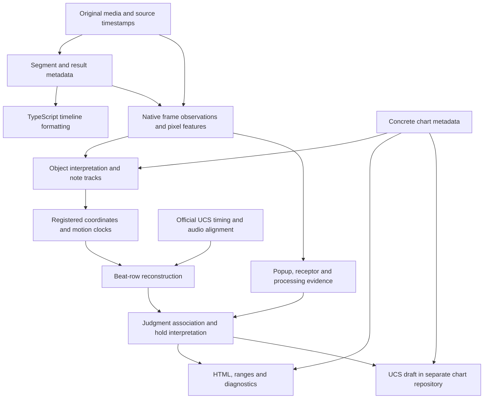

# Current play-analysis data flow

This describes the implemented pipeline and its remaining coupling. It is not a
claim that the stages are already independently resumable or fully validated.

## Entry points and outputs

`just auto` opens/downloads media, recognizes segment/song/chart/player/result
metadata, and runs a TypeScript timeline format. Its metadata document is
`.local/data/<source>/analysis/analysis.json`.

`just play` consumes that document and analyzes a selected gameplay segment.
Its working directory is `.local/data/<source>/play/segment-NNN/`, with a separate
`analysis.json` and `report.html`. Timeline formatting and play analysis are
separate entry points.

The diagram groups responsibilities; it does not imply four independent workers
or one immutable file per box. Some associations are calculated provisionally
and then rebuilt after target times or hold interpretations change.

## Data boundaries

| Stage | Code ownership | Principal stored data |
| --- | --- | --- |
| Metadata | `metadata/`, `vision/`, `workflow.py` | Song/chart/player identity, segment bounds, stage-result OCR |
| Pixel and frame acquisition | `play/observations/`, `play/frames.py`, `play/skins/`, `play/holds/features.py`, `play/judgments.py` | `frames.base.jsonl`, `frames.jsonl`, `judgments.jsonl`, `hold-frames.jsonl`, feature masks and manifests |
| Object/track/coordinate interpretation | `play/object_roles.py`, `play/tracking.py`, `play/head_registration.py`, `play/shared_timing.py` | Original detections, interpreted tracks, native registration, shared displacement and target-clock evidence |
| Musical timing | `play/beats/` | Beat candidates, unique/ambiguous/failed rows, independent-reference proofs and recovery |
| Evidence association | `play/judgments.py`, `play/holds/`, `play/processing/`, `play/channels.py` | Popup links, sustained holds, lane effects, disappearance/passage and unresolved states |
| Consumption | `play/report.py`, `play/ranges.py`, `charts/data.py`, `charts/transcription.py` | HTML, diagnostics, target/input ranges and per-measure UCS rows |

The four visual channels are popup changes, receptor effects, note movement and
note processing. They preserve separate observations and counts; one popup may
serve a chord, and repeated hold judgments are not repeated presses. Stage-result
counts are a consistency reference. A receptor effect is a visual input proxy,
not a measurement of a physical switch. See [visual channels](visual-channels.md).

Original recordings and source timestamps remain unchanged. Feature masks are
not lossless RGB frames: changing acquisition requirements can require reading
the original video again. Derived-rule changes can often reuse existing frame
observations, but that still involves reading and processing those artifacts.

Official UCS downloads supply timing/BPM structure, not chart-note positions.
Draft notes come from interpreted visible chart evidence. Concrete chart metadata
can authorize special processing; it must not manufacture observations or turn
unexplained conflicts into successes. Editable UCS/chart facts live separately
from this code repository.

## Current coupling and repeated work

`play/analysis.py` coordinates acquisition/refit, object interpretation, head
registration, beat reconstruction, reassociation, judgment augmentation, hold
augmentation, report generation and chart registration. These are functions in
separate modules, but their persisted boundaries are incomplete.

* `analysis.json` combines motion measurements, proposed chart times, recovered
  rows and association results. The normal command does not persist a dedicated,
  independently contracted pre-beat snapshot. Diagnostic boundary captures exist
  locally, but are not a supported resume layer.
* `TIMING_FORMAT` combines counter, head-registration, shared-motion, beat and
  object-interpretation contracts. A beat-only change can invalidate the overall
  timing result and trigger `refit_saved` from frame observations.
* `refit_saved` copies the existing segment directory, relocates evidence paths,
  replays frame observations and rebuilds tracks/clocks. A reviewed segment
  directory occupied approximately 3.7 GB. No new RGB decoding is needed for that
  path, but copying and replaying are still substantial work.
* `write_report` also calculates projections, ranges, continuity and recognition
  diagnostics and reads saved frame traces. It is not a pure HTML renderer.
* Hold geometry, popup association, lane evidence and processing have genuine
  dependencies, but the current cache fingerprints include broad combined
  analysis objects. A downstream change can therefore cause wider recomputation.

A cleaner boundary would persist immutable native measurements and independently
versioned track/coordinate, musical-timing, association and presentation results.
Each consumer should declare exactly which producer output and geometry units it
uses. This is a structural follow-up, not an implemented replacement in this change.

## Validation and geometry scope

Beat/reference/spacing acceptance limits now use fractions of measured lane
spacing. Stored source coordinates and review measurements can remain pixel
valued, with the model's scale recorded explicitly. Time limits remain seconds.
Missing scale is not replaced by an assumed game resolution. Actual raster and
template measurement uncertainty remains distinct from an acceptance threshold.

Other acquisition and motion-fitting code still contains pixel-valued precision
constants. This change does not claim that every stage is resolution invariant.

The chart-derived observation generator and JSON-to-beat-to-UCS-row matrix are
described in [testing](testing.md). They cover natural rhythms, chords, close
staggers, geometry, lane count and frame rate at the native-observation boundary.
They do not yet provide broad skin/image, short-hold or four-channel-combination
coverage. Passing these tests is not a measured corpus recognition rate.
