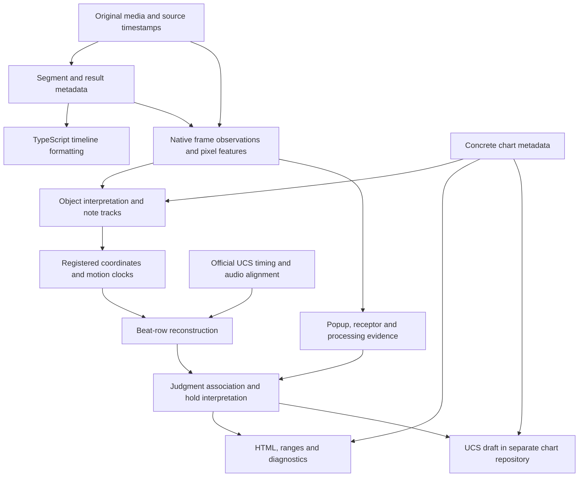

# Current play-analysis data flow

This describes the implemented pipeline and its remaining coupling. It is not a
claim that the stages are already independently resumable or fully validated.

## Entry points and outputs

`just auto` opens/downloads media, recognizes segment/song/chart/player/result
metadata, and runs a TypeScript timeline format. Its metadata document is
`.local/data/<source>/analysis/analysis.json`.

`just play` consumes that document and analyzes a selected gameplay segment.
Its working directory is `.local/data/<source>/play/segment-NNN/`, with a separate
`analysis.json` and `report.html`. Timeline formatting and play analysis are
separate entry points.

The diagram groups responsibilities; it does not imply four independent workers
or one immutable file per box. Some associations are calculated provisionally
and then rebuilt after target times or hold interpretations change.

## Data boundaries

| Stage | Code ownership | Principal stored data |
| --- | --- | --- |
| Metadata | `metadata/`, `vision/`, `workflow.py` | Song/chart/player identity, segment bounds, stage-result OCR |
| Pixel and frame acquisition | `play/observations/`, `play/frames.py`, `play/skins/`, `play/holds/features.py`, `play/judgments.py` | `frames.base.jsonl`, `frames.jsonl`, `judgments.jsonl`, `hold-frames.jsonl`, feature masks and manifests |
| Object/track/coordinate interpretation | `play/object_roles.py`, `play/tracking.py`, `play/head_registration.py`; TypeScript `derived/registration.ts`, `derived/tracks.ts`, `derived/clocks.ts` | Original detections, interpreted tracks, native registration, shared displacement and target-clock evidence |
| Musical timing | `derived/beats/` (TypeScript), `play/beats/timing.py` (reference preparation) | Beat candidates, unique/ambiguous/failed rows, independent-reference proofs and recovery |
| Evidence interpretation | Python `play/holds/`, `play/processing/`, `play/channels.py`; TypeScript `derived/labels.ts`, `derived/recovery.ts`, `derived/hold_projection.ts`, `derived/hold_presentation.ts` | Independent native states, popup links, sustained holds, lane effects and unresolved associations |
| Consumption | Python `play/presentation.py` orchestration; TypeScript `derived/ranges.ts`, `derived/visibility.ts`, `derived/diagnostics.ts`, `derived/report.ts`, `derived/charts/` | HTML, diagnostics, target/input ranges and per-measure UCS drafts |

The four visual channels are popup changes, receptor effects, note movement and
note processing. They preserve separate observations and counts; one popup may
serve a chord, and repeated hold judgments are not repeated presses. Stage-result
counts are a consistency reference. A receptor effect is a visual input proxy,
not a measurement of a physical switch. See [visual channels](visual-channels.md).

Original recordings and source timestamps remain unchanged. Feature masks are
not lossless RGB frames: changing acquisition requirements can require reading
the original video again. Derived-rule changes can often reuse existing frame
observations, but that still involves reading and processing those artifacts.

Official UCS downloads supply timing/BPM structure, not chart-note positions.
Draft notes come from interpreted visible chart evidence. Concrete chart metadata
can authorize special processing; it must not manufacture observations or turn
unexplained conflicts into successes. Editable UCS/chart facts live separately
from this code repository.

## Current coupling and repeated work

`play/analysis.py` coordinates acquisition/refit, object interpretation, head
registration, beat reconstruction, reassociation, judgment augmentation, hold
augmentation, report generation and chart registration. These are functions in
separate modules, but their persisted boundaries are incomplete.

* `coordinates.json` now preserves the registered pre-beat output with its own
  source/geometry/producer identity and content fingerprint. Segment-local paths
  are stored relative to that artifact so promotion does not invalidate it.
* `TIMING_FORMAT` covers upstream reconstruction only; musical timing retains its
  own contract. A beat-only change can resume `coordinates.json` without frame
  replay or copying the segment. Legacy analyses need one upstream refit to
  create this boundary; missing or incompatible snapshots cannot be invented.
* `beat-input.json` contains the prepared reference text and calculation inputs.
  TypeScript reconstructs musical timing in one call and returns only owned
  output fields. Acquisition identity stays outside numerical calculations.
* Native/skin/object changes still require `refit_saved`, which copies a pending
  segment and replays saved observations. That path has not been replaced by a
  universal independently cached stage graph.
* `play/presentation.py` invokes derived projections, ranges and diagnostics, persists
  `report-data.json`, and emits review warnings. `play/report.py` passes that
  prepared document to the pure TypeScript HTML renderer. The index reads a
  small prepared summary instead of rerunning analysis. Re-rendering prepared
  data does not inspect observations. Preparation still reads frame traces.
* Hold geometry, popup association, lane evidence and processing still have
  broad fingerprints. Their acquisition and derived consumers are not yet all
  separate persisted stages.

The saved-data runtime and standalone replay commands are described in
[derived analysis](derived-analysis.md).

## Validation and geometry scope

Beat/reference/spacing acceptance limits now use fractions of measured lane
spacing. Stored source coordinates and review measurements can remain pixel
valued, with the model's scale recorded explicitly. Time limits remain seconds.
Missing scale is not replaced by an assumed game resolution. Actual raster and
template measurement uncertainty remains distinct from an acceptance threshold.

Other acquisition and motion-fitting code still contains pixel-valued precision
constants. This change does not claim that every stage is resolution invariant.

The chart-derived observation generator and JSON-to-beat-to-UCS-row matrix are
described in [testing](testing.md). They cover natural rhythms, chords, close
staggers, geometry, lane count and frame rate at the native-observation boundary.
They do not yet provide broad skin/image, short-hold or four-channel-combination
coverage. Passing these tests is not a measured corpus recognition rate.
