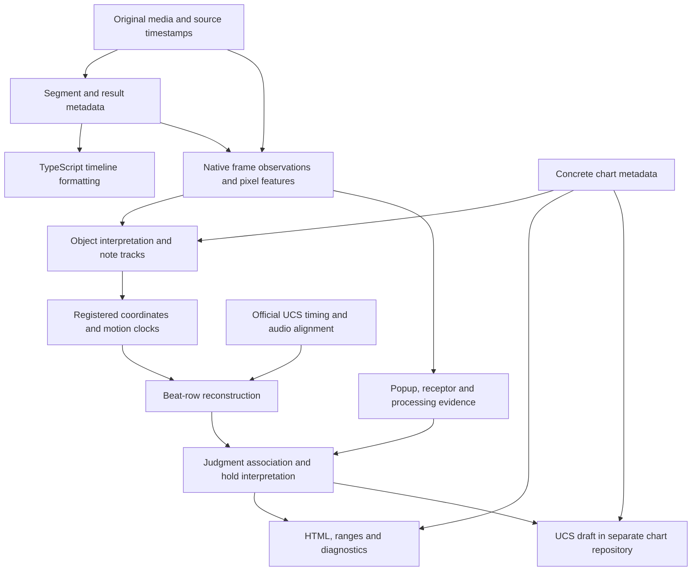

# Current play-analysis data flow

This describes implemented stage boundaries, cache dependencies and validation
limits. Stored observations are inputs to independently repeatable consumers.

## Entry points and outputs

`just auto` opens/downloads media, recognizes segment/song/chart/player/result
metadata, and runs a TypeScript timeline format. Its metadata document is
`.local/data/<source>/analysis/analysis.json`.

`just play` consumes that document and analyzes a selected gameplay segment.
Its working directory is `.local/data/<source>/play/segment-NNN/`, with a separate
`analysis.json` and `report.html`. Timeline formatting and play analysis are
separate entry points.

The diagram groups responsibilities; it does not imply four independent workers
or one immutable file per box. Some associations are calculated provisionally
and then rebuilt after target times or hold interpretations change.

See [coordinate frames and stage inputs](coordinate-model.md) for position units,
anchor conventions, typed views and consumer permissions.

## Data boundaries

| Stage | Code ownership | Principal stored data |
| --- | --- | --- |
| Metadata | `metadata/`, `vision/`, `workflow.py` | Song/chart/player identity, segment bounds, stage-result OCR |
| Pixel and frame acquisition | `play/observations/`, `play/frames.py`, `play/skins/`, `play/holds/features.py`, `play/judgments.py` | `frames.base.jsonl`, `frames.jsonl`, `judgments.jsonl`, `hold-frames.jsonl`, feature masks and manifests |
| Object/track/coordinate interpretation | `play/object_roles.py`, `play/tracking.py`, `play/head_registration.py`; TypeScript `derived/registration.ts`, `derived/tracks.ts`, `derived/clocks.ts` | Original detections, interpreted tracks, native registration, shared displacement and target-clock evidence |
| Musical timing | `derived/beats/` (TypeScript), `play/beats/timing.py` (reference preparation) | Beat candidates, unique/ambiguous/failed rows, independent-reference proofs and recovery |
| Evidence interpretation | Python `play/holds/`, `play/processing/`, `play/channels.py`; TypeScript `derived/labels.ts`, `derived/recovery.ts`, `derived/hold_projection.ts`, `derived/hold_presentation.ts` | Independent native states, popup links, sustained holds, lane effects and unresolved associations |
| Consumption | Python `play/presentation.py` orchestration; TypeScript `derived/ranges.ts`, `derived/visibility.ts`, `derived/diagnostics.ts`, `derived/report.ts`, `derived/charts/` | HTML, diagnostics, target/input ranges and per-measure UCS drafts |

The four visual channels are popup changes, receptor effects, note movement and
note processing. They preserve separate observations and counts; one popup may
serve a chord, and repeated hold judgments are not repeated presses. Stage-result
counts are a consistency reference. A receptor effect is a visual input proxy,
not a measurement of a physical switch. See [visual channels](visual-channels.md).

Original recordings and source timestamps remain unchanged. Feature masks are
not lossless RGB frames: changing acquisition requirements can require reading
the original video again. Derived-rule changes can often reuse existing frame
observations, but that still involves reading and processing those artifacts.

Official UCS downloads supply timing/BPM structure, not chart-note positions.
Draft notes come from interpreted visible chart evidence. Concrete chart metadata
can authorize special processing; it must not manufacture observations or turn
unexplained conflicts into successes. Editable UCS/chart facts live separately
from this code repository.

## Stage execution and cache reuse

`play/analysis.py` schedules source acquisition/refit, registered coordinates,
musical timing, native judgment/hold measurements, presentation and chart
registration. Scheduling does not give report consumers access to a decoder.

* `coordinates.json` preserves registered pre-beat output with source, geometry,
  producer identity and a content fingerprint. Musical timing has its own
  contract; a beat-only change resumes this boundary without frame replay.
* `beat-input.json` stores reference text and calculation inputs. TypeScript
  returns only owned fields; acquisition identity stays outside numerical fits.
* Native geometry, note processing and type observations have separate cached
  outputs under `native-stages/`. Hold geometry does not depend on HUD refreshes.
  `hold-state-input.json` feeds the independent TypeScript sustained-state stage.
  `holds.json` and `visual-channels.json` assemble these outputs for callers.
* `presentation-input.json` binds prepared external metadata, native proofs and
  compact channel records. TypeScript consumers prepare chart/input views,
  ranges, continuity and diagnostics, with separate artifacts and a dependency
  manifest under `derived-stages/`. Changing a counter observation does not rerun
  the visibility consumer; changing a title does not rerun inference.
* Native processing under configured motion is an explicit measurement producer.
  Its output is bound to the interpreted geometry and concrete motion model.
  A prepared consumer cannot request new pixel reads through a callback.
* `report-data.json` feeds the pure HTML renderer. `report-summary.json` feeds
  the index. Re-rendering either view performs no analysis or frame reads.
* `ucs-input.json` stores chart observations, exact reference timing and alignment
  for an independent UCS draft. Chart-repository registration is a separate I/O
  operation that preserves human edits.

Artifact reuse requires matching declared inputs and producer identities.
Corrupted output hashes or contradictory source timelines fail explicitly.
The maintenance scheduler checks the stage manifest and native producers before
classifying an analysis as current. Existing plays produce these artifacts on
an ordinary `just play` refresh; no data-migration command is required.

Native detector/geometry refits still use a pending segment and atomic directory
promotion. That transaction can copy retained acquisition artifacts. It does not
make downstream rule changes require a native refit or original-video decoding.
Changed acquisition requirements can require the original recording; retained
feature masks cannot supply pixels they never captured.

See [derived analysis](derived-analysis.md) for stage contracts and standalone
replay commands.

## Validation and geometry scope

Beat/reference/spacing acceptance limits now use fractions of measured lane
spacing. Stored source coordinates and review measurements can remain pixel
valued, with the model's scale recorded explicitly. Time limits remain seconds.
Missing scale is not replaced by an assumed game resolution. Actual raster and
template measurement uncertainty remains distinct from an acceptance threshold.

Other acquisition and motion-fitting code still contains pixel-valued precision
constants. This change does not claim that every stage is resolution invariant.

The chart-derived observation generator and JSON-to-beat-to-UCS-row matrix are
described in [testing](testing.md). They cover natural rhythms, chords, close
staggers, geometry, lane count and frame rate at the native-observation boundary.
They do not yet provide broad skin/image, short-hold or four-channel-combination
coverage. Passing these tests is not a measured corpus recognition rate.
